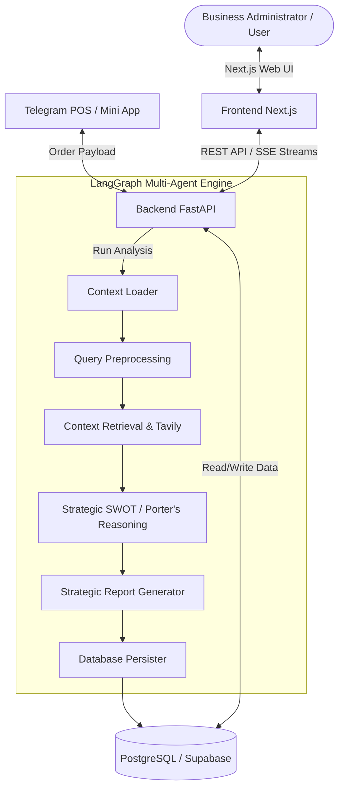

# Agentic BI Dashboard

A comprehensive, state-of-the-art Business Intelligence (BI) platform that leverages a multi-agent AI engine to analyze operational data, automate data ingestion, and generate strategic business insights.

The system is fully containerized and features a Next.js frontend, a FastAPI backend, a LangGraph agentic reasoning pipeline, and integration with Telegram for remote Point-of-Sale (POS) operations.

---

## 🛠️ Architecture Overview

The application is structured as follows:



---

## 🌟 Core Features

### 1. Multi-Agent Strategic Reasoning Pipeline
Powered by **LangGraph**, the agentic engine processes business analysis requests through a structured state-graph:
* **Context Loader**: Gathers business-specific parameters, history, and database schema mappings.
* **Preprocessing**: Standardizes search queries, identifies key performance indicators (KPIs), timeframes, and regions.
* **Context Retrieval**: Runs targeted database queries and performs external web searches via the **Tavily API** to collect market contexts.
* **Strategic Reasoning**: Evaluates SWOT matrices and Porter’s Five Forces based on current business metrics and external market trends.
* **Generation**: Generates comprehensive, markdown-formatted strategic reports.
* **Persister**: Automatically logs report history and updates analytical snapshots in the database.

### 2. Interactive Analytical Dashboards
* **Operational Dashboard**: Monitor real-time sales, transaction volumes, active branches, and operational metrics.
* **Strategic Insights**: View, trigger, and read detailed AI-generated strategic reports on demand.
* **Pivot Data Grid**: Explore database records dynamically with interactive sorting, filtering, and grouping.

### 3. Telegram Point-of-Sale (POS) Mini App (TMA)
Integrates a Telegram Mini App allowing cashiers in the field to:
* Validate cashier registration and branch allocation via `telegram_id`.
* Process and record single checkouts or bulk orders directly.
* Instantly commit transaction logs into the central PostgreSQL/Supabase database.

### 4. Smart Data Integration
* Supports importing data via CSV, Excel, and PDF formats.
* Features automatic database schema field matching and validation.

---

## 💻 Tech Stack

* **Backend**: FastAPI, LangGraph, LangChain, SQLAlchemy, PostgreSQL, Supabase Python SDK, Uvicorn, Pandas, NumPy.
* **Frontend**: Next.js (React), Tailwind CSS, Shadcn UI, ReUI (Data Grid), Lucide React, Telegram WebApp SDK.
* **Database**: PostgreSQL (Data Warehouse), Supabase (Auth, RLS, Storage).
* **DevOps**: Docker, Docker Compose, GitLab CI.
* **E2E Testing**: Selenium WebDriver, Webdriver Manager.

---

## 📁 Project Structure

```text
├── backend/
│   ├── app/
│   │   ├── agents/          # LangGraph state workflow, nodes, and state definitions
│   │   ├── api/             # FastAPI routers (dashboard, strategic, ingestion, telegram)
│   │   ├── core/            # Configs, Database engines, and Security utilities
│   │   ├── models/          # SQLAlchemy Database ORM Models
│   │   └── main.py          # FastAPI server entry point
│   ├── data/                # Local configuration and temporary analytical data
│   ├── scripts/             # DB migration SQL scripts & python seeds
│   ├── Dockerfile
│   └── requirements.txt
├── frontend/
│   ├── components/          # Reusable UI widgets and custom layout components
│   ├── lib/                 # Core client utilities (Supabase, axios instance)
│   ├── pages/               # Next.js page views (Operational, Strategic, TMA, Settings)
│   ├── styles/              # Global CSS & Tailwind styles
│   ├── Dockerfile
│   └── package.json
├── docker-compose.yml
├── selenium_test.py         # End-to-end Selenium automation test suite
└── README.md
```

---

## 🚀 Getting Started

### Prerequisites
* Python 3.10+
* Node.js 18+
* PostgreSQL / Supabase Database URL
* API Keys (Groq & Tavily)

### 1. Database Setup
Execute the migration scripts in your database instance to set up tables, relationships, and triggers:
```bash
# In your database SQL editor
# Execute backend/scripts/migration_v2.sql to set up RLS policies and base schemas.
```

### 2. Backend Setup
1. Navigate to the backend directory:
   ```bash
   cd backend
   ```
2. Create and activate a virtual environment:
   ```bash
   python -m venv venv
   # On Windows:
   .\venv\Scripts\activate
   # On macOS/Linux:
   source venv/bin/activate
   ```
3. Install dependencies:
   ```bash
   pip install -r requirements.txt
   ```
4. Create a `.env` file in the `backend/` directory:
   ```env
   SUPABASE_URL=your_supabase_url
   SUPABASE_ANON_KEY=your_supabase_anon_key
   DATABASE_URL=postgresql://your_db_credentials
   GROQ_API_KEY=gsk_your_groq_api_key
   TAVILY_API_KEY=tvly-your_tavily_api_key
   ```
5. Run the local backend server:
   ```bash
   python -m uvicorn app.main:app --reload
   ```

### 3. Frontend Setup
1. Navigate to the frontend directory:
   ```bash
   cd frontend
   ```
2. Install npm packages:
   ```bash
   npm install
   ```
3. Create a `.env.local` file in the `frontend/` directory:
   ```env
   NEXT_PUBLIC_API_URL=http://localhost:8000
   NEXT_PUBLIC_SUPABASE_URL=your_supabase_url
   NEXT_PUBLIC_SUPABASE_ANON_KEY=your_supabase_anon_key
   ```
4. Run the frontend development server:
   ```bash
   npm run dev
   ```
   Open [http://localhost:3000](http://localhost:3000) to view the web dashboard.

---

## 🐳 Running with Docker

You can spin up the entire stack (Frontend + Backend) locally with Docker Compose:

1. Ensure your backend environment variables are set in `./backend/.env`.
2. Start the services:
   ```bash
   docker-compose up --build
   ```
3. Access the frontend at [http://localhost:3000](http://localhost:3000) and the backend API at [http://localhost:8000/docs](http://localhost:8000/docs).

---

## 🤖 Telegram Integration Setup

To connect the Telegram Mini App (TMA) to your local environment:
1. Run a tunnel (e.g., Cloudflare Tunnel / Ngrok) to expose your local FastAPI backend:
   ```bash
   # Example using Cloudflare Quick Tunnel:
   cloudflared tunnel --url http://localhost:8000
   ```
2. Copy the generated public tunnel URL and set it as `NEXT_PUBLIC_API_TUNNEL_URL` in the frontend environment.
3. Configure your Telegram Bot WebApp URL in BotFather to point to the frontend deployment or your tunnel endpoint hosting the `/tma` route.

---

## 🧪 Automated Testing

An end-to-end integration test suite is provided via [selenium_test.py](file:///d:/Magang/WIT%20Indonesia%20-%20Fullstack%20AI%20Developer/product-agentic-bi-dashboard-29b14eff58c869fb9b8cbcebde110afa06fd2cbf/Dashboard%20Agentic%20BI/selenium_test.py).

To execute the tests:
1. Ensure both your frontend (`localhost:3000`) and backend (`localhost:8000`) servers are running.
2. Install Selenium and webdriver-manager in your local python environment:
   ```bash
   pip install selenium webdriver-manager
   ```
3. Run the automation script:
   ```bash
   python selenium_test.py
   ```
   *The script automatically injects mock JWT headers to test operational dashboards, strategic report views, and master tables without requiring live login overrides.*

